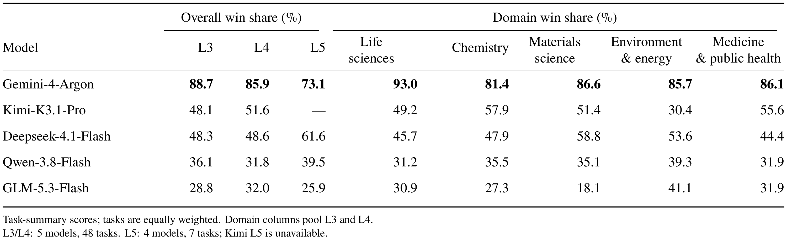
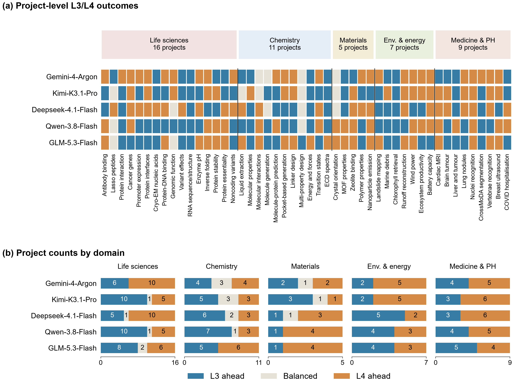
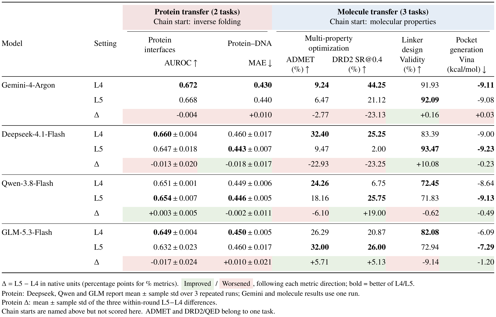
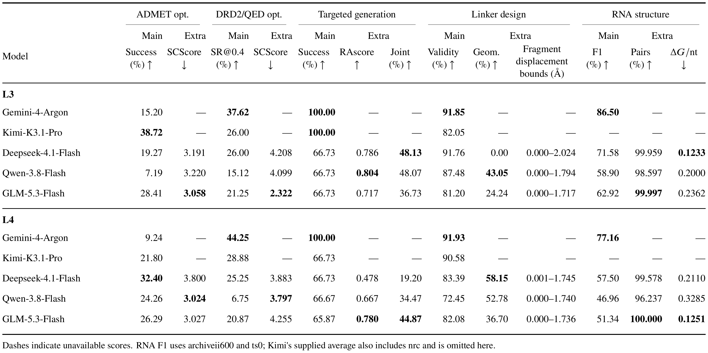

# RSI4S-Bench

**A benchmark for self-improving scientific agents** — 48 scientific tasks, evaluated at three levels (L3 / L4 / L5).

**English** · [简体中文](README.zh-CN.md)

Each task gives an agent system a scientific objective, authorized data and a shared **four-hour research budget**. Two agents work inside it:

- **Task Agent** reads the task, writes and runs code, trains models, evaluates on validation data and requests labels.
- **Meta Agent** reviews the history, improves the next Task Agent (prompt, tools, control flow) and decides which labels to buy.

After research, Meta selects one existing model; the host freezes it and scores it **once** on the held-out Test set. Test results never reach the agents. `MAT_01` and `CHEM_01` are simulated experiments without a Test set; see section 5 for how they are scored.

| Level | What may change | How to run |
| --- | --- | --- |
| **L3** | Task revises its own research program; Meta's definition is fixed. | batch runner, mode `fixed` |
| **L4** | Task and Meta both evolve (sources, prompts, tools). | batch runner, mode `coevolve` |
| **L5** | L4 within each task, plus the distilled agents and research notes carried along a task chain. | batch runner with `--chain` |

The batch runner always runs the matched pair L3 + L4 for the selected tasks; L5 is a separate study.

## Requirements

- **Linux x86_64, run as root.** Agent code runs in a sandbox that drops to a dedicated UID and applies Landlock (ABI ≥ 3) and seccomp (`libseccomp.so.2`).
- **One Python environment, `rsi4s`** (Python 3.11.16), from [`requirements.txt`](requirements.txt). Every task group, both simulators and the batch runner use it:

  ```bash
  git clone https://github.com/PKU-YuanGroup/RSI4S.git && cd RSI4S
  python3.11 -m venv /envs/rsi4s && /envs/rsi4s/bin/pip install -r requirements.txt
  ```

  The file adds the CUDA 12.1 wheel indexes for `torch`, `torchvision` and `dgl`. `prepare` and the simulators refuse an interpreter whose packages differ from `requirements.txt` in any way, extra packages included, because the environment defines which libraries the agents can use. Install nothing else into it; use another environment for your own tools.
- **A model API.** Supported identifiers (OpenAI-compatible chat completions with streaming):

  | `--model` | Provider |
  | --- | --- |
  | `deepseek-flash` | DeepSeek API |
  | `deepseek-v4.1-flash-1017` | DeepSeek on Alibaba Cloud Bailian |
  | `qwen3.8-flash` | Alibaba Cloud Bailian |
  | `ZHIPU/GLM-5.3-Flash` | Alibaba Cloud Bailian |
  | `mimo-v2.6-pro` | Xiaomi MiMo |
  | `gemini-4-argon` | Google Gemini API (OpenAI-compatible endpoint) or a compatible gateway |
  | `kimi-k3.1-pro` | Moonshot Kimi API |

  The `gemini-4-argon` and `kimi-k3.1-pro` request settings follow the providers' documentation; the Gemini results below were obtained through an OpenAI-compatible gateway, and neither setting has been checked against the official endpoints.

  Credentials are a JSON file kept outside the repository: `{"api_key": "sk-...", "base_url": "https://.../v1"}` (or `"api_key_file": "key.txt"` instead of `api_key`).

## 1. Download and unpack the data

The dataset is [`purshow/RSI4S-task48`](https://modelscope.cn/datasets/purshow/RSI4S-task48) on ModelScope (≈212 GB compressed, 317 GB unpacked). `rsi4s` includes `modelscope`, so the same interpreter downloads the data. If access is restricted, log in first: `/envs/rsi4s/bin/python -c "from modelscope.hub.api import HubApi; HubApi().login('<token>')"`.

```bash
/envs/rsi4s/bin/python - <<'PY'
from modelscope.hub.snapshot_download import dataset_snapshot_download
dataset_snapshot_download(dataset_id="purshow/RSI4S-task48", local_dir="./task48_download", max_workers=4)
PY
/envs/rsi4s/bin/python task48_download/tools/unpack.py --dest /data/rsi4s   # -> /data/rsi4s/rsi4s_task48/
```

To fetch only some tasks, pass `allow_patterns=["*.md", "*.json", "SHA256SUMS", "files.jsonl.gz", "tools/*", "archives/LIFE_06.tar.gz.part*"]` to `dataset_snapshot_download` and `--tasks LIFE_06` to `unpack.py`. `unpack.py` (Python ≥ 3.10, standard library only) verifies every archive part and every extracted file. The dataset's `TASKS.md` lists all 48 tasks.

## 2. Bind the data to this checkout

In the checkout:

```bash
python tools/setup_data.py --bundle /data/rsi4s/rsi4s_task48 --out /data/rsi4s/bound \
    --credentials /path/to/credentials.json --python /envs/rsi4s/bin/python
```

`setup_data.py` copies no data. It creates `/data/rsi4s/bound` (links into the dataset plus small writable state) and writes your paths and the `rsi4s` interpreter into the six task-group configs under `configs/` (`source /data/rsi4s/bound/env.sh` sets the optional `MEDRSEE_HOME` default). To change paths, run it again with a new `--out`, and prepare new studies with `--fresh-releases`. The dataset contains Test labels (`organizer/`); never expose it to the agents' environment.

## 3. Run L3 and L4

```bash
PY=/envs/rsi4s/bin/python
$PY -m maintenance.task48_prepare prepare --out runs/l3l4-qwen --model qwen3.8-flash --fresh-releases
$PY -m maintenance.task48 launch --out runs/l3l4-qwen
```

`prepare` checks every task group (data, the `rsi4s` environment, simulator sources), freezes code + data + environment into `provenance/releases/<run>/`, builds the ENV_02 Test-input cache when ENV_02 is included (≈3 GB, first time only) and sends one connectivity request to the model. Nothing starts if a check fails. `launch` then runs all **fixed (L3)** jobs, then all **coevolve (L4)** jobs, in waves of 16, and writes the report. A full study is 96 four-hour jobs: run `launch` under `tmux`/`nohup`.

Useful `prepare` options:

| Option | Effect |
| --- | --- |
| `--tasks LIFE_13 MED_02 ...` | run a subset of the 48 tasks |
| `--mode-order coevolve fixed` | run L4 before L3 |
| `--solve-seconds 1800` | shorter research budget (for a trial run, not for reported results) |
| `--credentials FILE` | override the configured credentials |
| `--api-max-retries N` | retries per model request (default 3) |

Run directories must be new and live under `runs/`. A study is never restarted implicitly; a failed job keeps its records and is reported as failed.

## 4. Run L5 (task chains)

```bash
$PY -m maintenance.task48_prepare prepare --out runs/l5-qwen --model qwen3.8-flash --fresh-releases \
    --chain protein=LIFE_13,LIFE_06,LIFE_08 \
    --chain molecule=CHEM_02,CHEM_08,CHEM_07,CHEM_06
$PY -m maintenance.task48 launch --out runs/l5-qwen
```

Each chain runs its tasks in order (chains run in parallel). After a task's final selection and before its Test scoring, Meta has a 30-minute distillation session outside the research budget; the Task/Meta agent sources and `research_experience.md` are sealed and the next task starts from them. Data, labels, history and Test results are never carried over. Compare an L5 task with the same task's L4 run. Options: `--chain-modes coevolve fixed` (also run a fixed-Meta chain), `--chain-distillation-seconds N`.

## 5. Read the results

| Path | Contents |
| --- | --- |
| `runs/<study>/report/summary.md` | study report; `runs.csv`, `metrics.csv`, `comparisons.csv` next to it |
| `runs/<study>/<mode>/<task>/summary.json` | one job: status, selected model, `final_test`, budget use |
| `runs/<study>/<mode>/<task>/` | full trajectory: conversations, agent source versions, evaluations, API usage |
| `runs/<study>/supervisor.json` | scheduler state of every job |
| `runs/<study>/environment.json` | CPU, GPU and kernel of the machine, recorded by `prepare` |

Metrics are each task's native metrics in their native units and directions. `MAT_01` and `CHEM_01` repeat episodes on one fixed scenario and report the best completed episode (`simulator/episodes.json` lists them all); they have no independent Test set.

## Rules

- Research uses Train and Validation only. Labels come from a shared query budget: 10% of the training pool labeled at start, up to another 50% purchasable (exact counts per task in its `problem/` directory). `MAT_01` and `CHEM_01` have no label pool; they spend only the simulator's action allowance.
- The 4-hour budget is one clock shared by all Task and Meta generations; at most 40 Task rounds. Failed model requests are retried and their time is returned to the clock (at most 1 hour per job).
- Test runs once, after Meta's final selection and the freeze, and is never fed back.
- No independent LLM judge is used; records show `judge.status=disabled`.

## Evaluate your own model or agent

- **Model:** add its identifier to `SUPPORTED_MODELS` and a request contract to `_API_CONTRACTS` in [`rsi/providers.py`](rsi/providers.py) (plus `_DOCUMENTED_LIMITS` if its `/models` endpoint does not report `max_output_tokens`). Then pass `--model`.
- **Agent:** the initial agents are [`agent/task/`](agent/task) and [`agent/meta/`](agent/meta) (entry point `step(state, context, response)`, prompts, tools). Keep the host interfaces, task definitions and evaluators unchanged; `prepare` freezes the new sources automatically.

Keep task set, budget, initial agent and hardware identical when comparing models.

## Repository layout

| Path | Contents |
| --- | --- |
| `run_rsi.py` | low-level CLI: `preflight`, `run` (one config group, no chains, no NatureBench Test scoring), `freeze`, `verify` |
| `maintenance/task48_prepare.py`, `maintenance/task48.py` | batch runner: `prepare`, `check`, `launch`, `report` |
| `tools/setup_data.py` | binds the dataset and writes the configs |
| `configs/` | six task-group configs, `task_48.json` (task → group index), task lists |
| `agent/` | initial Task and Meta agents |
| `rsi/` | host: scheduling, API client, budgets, sandbox, history, freeze, chains |
| `benchmarks/` | data access, output checks and scoring: `naturebench_active/`, `medrsee/`, `simulator/` |
| `tasks/` | task instructions shown to the agents: `naturebench-active/`, `medrsee/`, `simulator/`, `resp/` |
| `docs/task_48.md` | all 48 tasks with inputs, outputs and the L5 chains |

## Current results

<details>
<summary><b>Expand: preliminary results of five models on the 48 tasks (2026-11-10)</b></summary>

<br>

These results come from our reference machine, with the five per-group Python environments that preceded `rsi4s` (the header of `requirements.txt` lists the versions that changed when they were merged). Except for the L5 protein chain, every number is a single run. They show that the benchmark separates models and settings; they are not a final ranking. Click a figure for full resolution.

**1. Overall win share**

[](docs/figures/results-overall.png)

At each level, models are compared pairwise on every task's native metrics (win 1, tie 0.5, loss 0), then averaged with tasks weighted equally. The percentages are win shares, not task success rates. L3/L4 cover 5 models × 48 tasks; L5 covers 4 models × 7 tasks.

**Takeaway:** Gemini-4-Argon leads clearly at every level and in every domain.

**2. L3 versus L4, task by task**

[](docs/figures/results-l3-l4.png)

Each cell compares one model's L4 and L3 results on one task (orange: L4 ahead, blue: L3 ahead, grey: balanced). Across 240 model–task pairs, L4 leads in 113, L3 in 110, and 17 are balanced.

**Takeaway:** letting Meta modify itself (L4) gives no consistent gain; the effect depends on the model and the task.

**3. Cross-task transfer: L5 versus L4**

[](docs/figures/results-transfer.png)

L5 is L4 plus the agents and experience distilled from earlier tasks in the chain. Only the five tasks that actually inherit experience are shown; Δ = L5 − L4, green for improvement, red for deterioration. Protein-chain results for Deepseek, Qwen and GLM are mean ± standard deviation over three runs; all others are single runs.

**Takeaway:** transfer helps on some tasks and hurts on others; there is no general positive transfer yet.

**4. Supplementary scientific checks**

[](docs/figures/results-science.png)

Beyond the primary metrics, these checks cover synthetic difficulty (SCScore, RAscore), linker geometry and RNA structure; “—” marks an unavailable score. The linker Geom. column is the share of generated molecules that pass all PoseBusters bond-length, bond-angle, internal-clash and ring/double-bond flatness checks; molecules that cannot be checked stay in the denominator.

**Takeaway:** the primary metrics check only chemical validity, and the extra checks catch problems they miss. For example, Deepseek-4.1-Flash reaches 91.76% linker validity at L3, yet all 2,226 checkable molecules fail the bond-length and bond-angle checks (Geom. = 0); at L4 this recovers to 58.15%.

*Note: the existing `MAT_01` and `CHEM_01` results come from batches with different episode protocols; excluding these two tasks leaves the L3/L4 model ranking unchanged.*

</details>

## License and acknowledgments

RSI4S-Bench builds on NatureBench, HyperAgents and the scientific datasets listed in [NOTICE](NOTICE) and [upstream.json](upstream.json). Code: [LICENSE](LICENSE) and [HyperAgents license](HYPERAGENTS-LICENSE.md). Each task's source data keeps its upstream terms.
