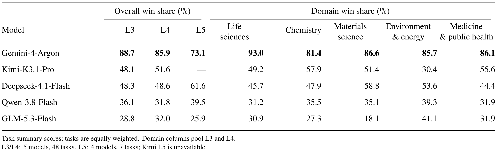
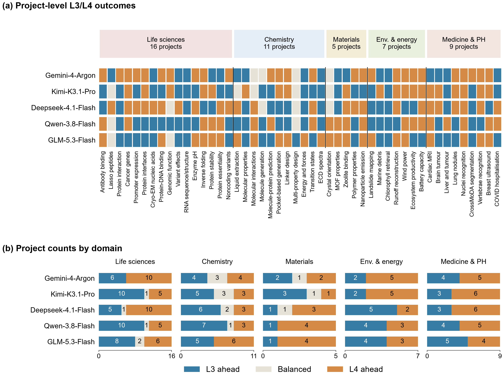
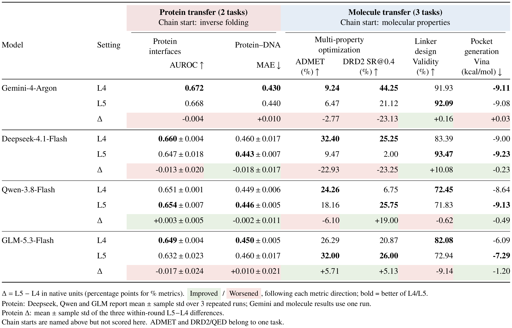
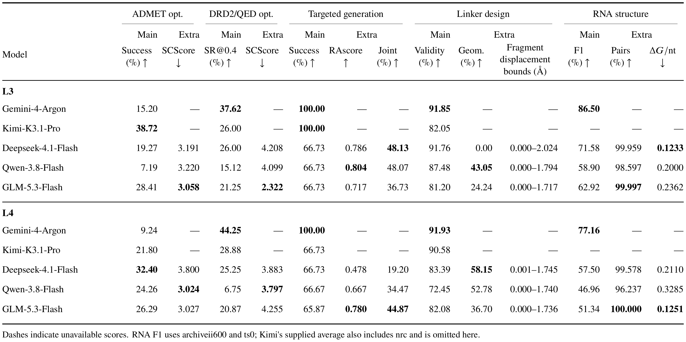

# RSI4S-Bench

**自我改进科研 Agent 的评测基准**：48 个科学任务，三个评测层级（L3 / L4 / L5）。

[English](README.md) · **简体中文**

每个任务给 Agent 系统一个科学目标、授权数据和共享的 **4 小时研究预算**。系统由两个角色组成：

- **Task Agent**：读取任务说明，写代码、训练模型、在验证集上评估，并提出标签请求。
- **Meta Agent**：回看历史，改进下一代 Task Agent（提示词、工具、控制流程），并决定购买哪些标签。

研究结束后，Meta 在已有产物中选定一个模型，宿主冻结后在 Test 上**只评分一次**。Test 结果不会反馈给 Agent。`MAT_01`、`CHEM_01` 是模拟实验，没有独立 Test，评分方式见第 5 节。

| 层级 | 可改变的内容 | 运行方式 |
| --- | --- | --- |
| **L3** | Task 可改自己的研究程序；Meta 的定义固定 | 批量运行器，模式 `fixed` |
| **L4** | Task 与 Meta 都可演化（源码、提示词、工具） | 批量运行器，模式 `coevolve` |
| **L5** | 每个任务内同 L4，另外沿任务链传递蒸馏后的 Agent 与科研笔记 | 批量运行器加 `--chain` |

批量运行器对所选任务总是成对运行 L3 + L4；L5 是单独的一次研究。

## 运行要求

- **Linux x86_64，以 root 运行。** Agent 代码在沙箱中执行：切换到专用 UID，并启用 Landlock（ABI ≥ 3）与 seccomp（`libseccomp.so.2`）。
- **一个 Python 环境 `rsi4s`**（Python 3.11.16），按 [`requirements.txt`](requirements.txt) 安装。所有任务组、两个模拟器和批量运行器都用它：

  ```bash
  git clone https://github.com/PKU-YuanGroup/RSI4S.git && cd RSI4S
  python3.11 -m venv /envs/rsi4s && /envs/rsi4s/bin/pip install -r requirements.txt
  ```

  文件里已加上 `torch`、`torchvision`、`dgl` 的 CUDA 12.1 下载源。环境决定了 Agent 能用哪些库，所以只要解释器里的包与 `requirements.txt` 有任何不同（包括多装的包），`prepare` 和模拟器都会拒绝运行。
- **模型 API。** 支持的模型（OpenAI 兼容、流式的 chat completions）：

  | `--model` | 提供方 |
  | --- | --- |
  | `deepseek-flash` | DeepSeek 官方 API |
  | `deepseek-v4.1-flash-1017` | 阿里云百炼上的 DeepSeek |
  | `qwen3.8-flash` | 阿里云百炼 |
  | `ZHIPU/GLM-5.3-Flash` | 阿里云百炼 |
  | `mimo-v2.6-pro` | 小米 MiMo |

  凭据是放在仓库外的 JSON 文件：`{"api_key": "sk-...", "base_url": "https://.../v1"}`（也可用 `"api_key_file": "key.txt"` 代替 `api_key`）。

## 1. 下载并解压数据

数据集为 ModelScope 上的 [`purshow/RSI4S-task48`](https://modelscope.cn/datasets/purshow/RSI4S-task48)（压缩约 212 GB，解压后 317 GB）。如需登录：`python -c "from modelscope.hub.api import HubApi; HubApi().login('<token>')"`。

```bash
pip install -U modelscope
python - <<'PY'
from modelscope.hub.snapshot_download import dataset_snapshot_download
dataset_snapshot_download(dataset_id="purshow/RSI4S-task48", local_dir="./task48_download", max_workers=4)
PY
python task48_download/tools/unpack.py --dest /data/rsi4s        # 输出 /data/rsi4s/rsi4s_task48/
```

只要部分任务时，给 `dataset_snapshot_download` 加 `allow_patterns=["*.md", "*.json", "SHA256SUMS", "files.jsonl.gz", "tools/*", "archives/LIFE_06.tar.gz.part*"]`，`unpack.py` 加 `--tasks LIFE_06`。`unpack.py` 只用标准库（Python ≥ 3.10），会校验每个分卷和每个解压出的文件。数据集的 `TASKS.md` 列出全部 48 个任务。

## 2. 把数据绑定到代码

在代码目录中运行：

```bash
python tools/setup_data.py --bundle /data/rsi4s/rsi4s_task48 --out /data/rsi4s/bound \
    --credentials /path/to/credentials.json --python /envs/rsi4s/bin/python
```

`setup_data.py` 不复制数据：它建立 `/data/rsi4s/bound`（指向数据集的链接和少量可写状态），并把你的路径和 `rsi4s` 解释器写入 `configs/` 下的六个任务组配置（`source /data/rsi4s/bound/env.sh` 可设置可选的 `MEDRSEE_HOME` 默认值）。路径变化时用新的 `--out` 重新运行，之后的研究用 `--fresh-releases` 准备。数据集含 Test 标签（`organizer/`），不要让 Agent 的环境访问它。

## 3. 运行 L3 和 L4

```bash
PY=/envs/rsi4s/bin/python
$PY -m maintenance.task48_prepare prepare --out runs/l3l4-qwen --model qwen3.8-flash --fresh-releases
$PY -m maintenance.task48 launch --out runs/l3l4-qwen
```

`prepare` 检查每个任务组（数据、`rsi4s` 环境、模拟器源文件），把代码、数据和环境冻结到 `provenance/releases/<运行名>/`；包含 ENV_02 时生成其 Test 输入缓存（约 3 GB，仅首次），并向模型发一次连通性请求。任何检查失败都不会启动。`launch` 先跑完全部 **fixed（L3）**，再跑全部 **coevolve（L4）**，每批 16 个，结束后写报告。完整一次共 96 个 4 小时作业，请在 `tmux`/`nohup` 下运行 `launch`。

常用 `prepare` 参数：

| 参数 | 作用 |
| --- | --- |
| `--tasks LIFE_13 MED_02 ...` | 只跑 48 个任务中的一部分 |
| `--mode-order coevolve fixed` | 先跑 L4 再跑 L3 |
| `--solve-seconds 1800` | 缩短研究预算（用于试跑，不用于报告结果） |
| `--credentials FILE` | 覆盖配置中的凭据 |
| `--api-max-retries N` | 每次模型请求的重试次数（默认 3） |

运行目录必须是 `runs/` 下的新目录。不会隐式重启；失败的作业保留记录并记为失败。

## 4. 运行 L5（任务链）

```bash
$PY -m maintenance.task48_prepare prepare --out runs/l5-qwen --model qwen3.8-flash --fresh-releases \
    --chain protein=LIFE_13,LIFE_06,LIFE_08 \
    --chain molecule=CHEM_02,CHEM_08,CHEM_07,CHEM_06
$PY -m maintenance.task48 launch --out runs/l5-qwen
```

每条链按顺序运行其任务（多条链并行）。每个任务完成最终选模后、Test 评分前，Meta 运行一次 30 分钟的蒸馏（不占研究预算），封存 Task/Meta Agent 源码和 `research_experience.md`，下一个任务从它启动。数据、标签、历史和 Test 结果都不传递。L5 任务应与同一任务的 L4 结果比较。可选：`--chain-modes coevolve fixed`（同时跑固定 Meta 的链）、`--chain-distillation-seconds N`。

## 5. 查看结果

| 位置 | 内容 |
| --- | --- |
| `runs/<研究>/report/summary.md` | 汇总报告；同目录有 `runs.csv`、`metrics.csv`、`comparisons.csv` |
| `runs/<研究>/<模式>/<任务>/summary.json` | 单个作业：状态、选定模型、`final_test`、预算使用 |
| `runs/<研究>/<模式>/<任务>/` | 完整轨迹：对话、Agent 源码版本、评估、API 用量 |
| `runs/<研究>/supervisor.json` | 各作业的调度状态 |
| `runs/<研究>/environment.json` | `prepare` 记录的本机 CPU、GPU 与内核信息 |

指标均为各任务原生指标，保持原单位与方向。`MAT_01`、`CHEM_01` 在同一固定情景上重复 episode，取已完成且主指标有效的最佳 episode（全部记录在 `simulator/episodes.json`），没有独立 Test。

## 评测规则

- 研究期只使用 Train 与 Val。标签来自共享查询预算：开始时标注训练池的 10%，最多再购买 50%（各任务的具体数量见其 `problem/` 目录下的说明）。`MAT_01`、`CHEM_01` 没有标签池，只消耗模拟器的动作配额。
- 4 小时是所有 Task 与 Meta 代际共用的一个时钟，最多 40 轮 Task。模型请求失败会重试，失败耗时退回时钟（每个作业最多 1 小时）。
- Test 只在 Meta 最终选模并冻结后运行一次，结果不回传。
- 不使用独立 LLM Judge，记录为 `judge.status=disabled`。

## 评测自己的模型或 Agent

- **模型：** 在 [`rsi/providers.py`](rsi/providers.py) 的 `SUPPORTED_MODELS` 中加入模型名，在 `_API_CONTRACTS` 中写请求约定（若其 `/models` 不返回 `max_output_tokens`，再加 `_DOCUMENTED_LIMITS`），然后用 `--model` 指定。
- **Agent：** 初始 Agent 在 [`agent/task/`](agent/task) 与 [`agent/meta/`](agent/meta)（入口 `step(state, context, response)`、提示词、工具）。保持宿主接口、任务定义和评估器不变；`prepare` 会自动冻结新的源码。

比较模型时保持任务集、预算、初始 Agent 和硬件一致。

## 目录结构

| 路径 | 内容 |
| --- | --- |
| `run_rsi.py` | 底层命令：`preflight`、`run`（单个配置组，无任务链、无 NatureBench Test 评分）、`freeze`、`verify` |
| `maintenance/task48_prepare.py`、`maintenance/task48.py` | 批量运行器：`prepare`、`check`、`launch`、`report` |
| `tools/setup_data.py` | 绑定数据集并写入配置 |
| `configs/` | 六个任务组配置、`task_48.json`（任务到分组的索引）、任务清单 |
| `agent/` | 初始 Task 与 Meta Agent |
| `rsi/` | 宿主：调度、API 客户端、预算、沙箱、历史、冻结、任务链 |
| `benchmarks/` | 数据授权、输出校验与评分：`naturebench_active/`、`medrsee/`、`simulator/` |
| `tasks/` | 给 Agent 的任务说明：`naturebench-active/`、`medrsee/`、`simulator/`、`resp/` |
| `docs/task_48.md` | 48 个任务的输入、输出及 L5 任务链 |

## 现阶段结果

<details>
<summary><b>展开：五个模型在 48 项任务上的初步结果（2026-11-10）</b></summary>

<br>

以下结果来自我们的参考机器，使用的是合并为 `rsi4s` 之前的五个分组环境（合并时改变的包版本见 `requirements.txt` 开头）；除 L5 蛋白链外均为单次运行，用于说明基准能区分模型与设置，不作为最终排名。点击图片查看原图。

**1. 总体胜率**

[](docs/figures/results-overall.png)

同一层级内，模型在每个任务上两两比较原生指标（胜 1、平 0.5、负 0），再按任务等权汇总；百分比是胜率，不是任务成功率。L3/L4 为 5 个模型 × 48 项任务，L5 为 4 个模型 × 7 项任务。

**初步结论：** Gemini-4-Argon 在各层级、各领域都明显领先。

**2. L3 与 L4 逐任务对比**

[](docs/figures/results-l3-l4.png)

每一格比较同一模型在同一任务上的 L4 与 L3（橙色 L4 领先，蓝色 L3 领先，灰色持平）。240 个模型–任务对中，L4 领先 113 个，L3 领先 110 个，持平 17 个。

**初步结论：** 让 Meta 也能自我修改（L4）没有带来一致收益，效果随模型和任务而变。

**3. 跨任务迁移：L5 对比 L4**

[](docs/figures/results-transfer.png)

L5 在 L4 的基础上继承前序任务蒸馏出的 Agent 与经验。表中只列出真正发生迁移的 5 个任务，Δ = L5 − L4，绿色为改善，红色为变差。蛋白链中 Deepseek、Qwen、GLM 为 3 次运行的均值 ± 标准差，其余为单次运行。

**初步结论：** 迁移效果有升有降，目前还看不到普遍的正迁移。

**4. 补充科学检查**

[](docs/figures/results-science.png)

在主指标之外，补充合成难度（SCScore、RAscore）、连接体几何和 RNA 结构等检查；“—”表示暂无该项成绩。连接体的 Geom. 列是生成分子同时通过 PoseBusters 键长、键角、内部碰撞和环/双键平面性检查的比例，无法判定的分子计入分母。

**初步结论：** 主指标只检查化学有效性，补充检查能发现它看不到的问题。例如 Deepseek-4.1-Flash 的 L3 连接体有效率为 91.76%，但可判定的 2,226 个分子全部未通过键长和键角检查（Geom. = 0），L4 回升到 58.15%。

*注：`MAT_01`、`CHEM_01` 的已有结果来自 episode 协议不同的批次；剔除这两项后，L3/L4 的模型排名不变。*

</details>

## 许可与致谢

RSI4S-Bench 基于 NatureBench、HyperAgents 以及 [NOTICE](NOTICE) 和 [upstream.json](upstream.json) 中列出的科学数据集。代码许可见 [LICENSE](LICENSE) 与 [HyperAgents 许可证](HYPERAGENTS-LICENSE.md)。各任务的源数据遵循其上游许可。
